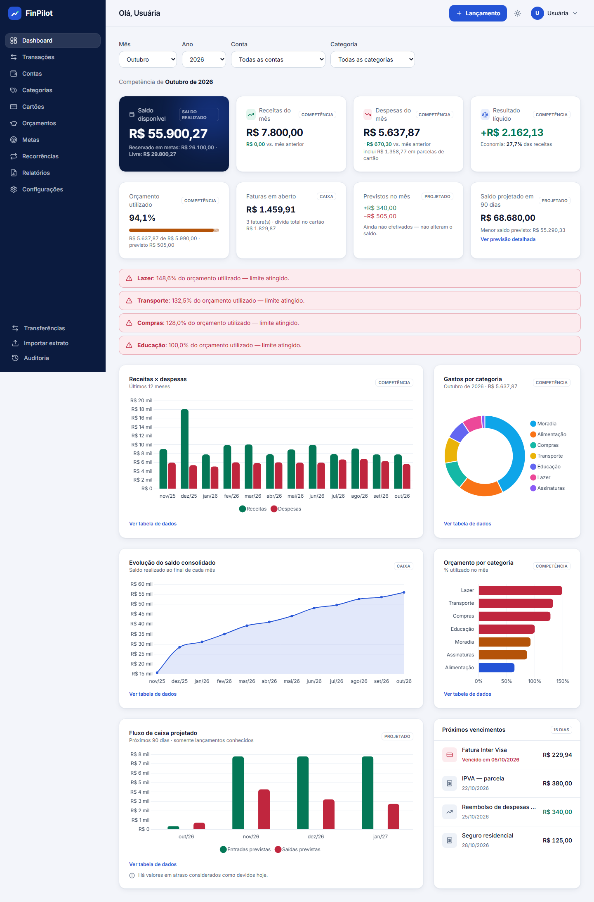
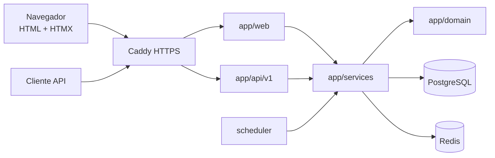
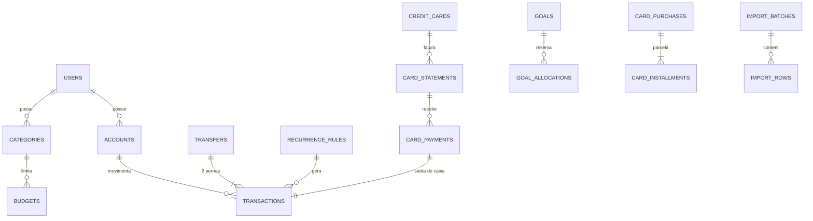
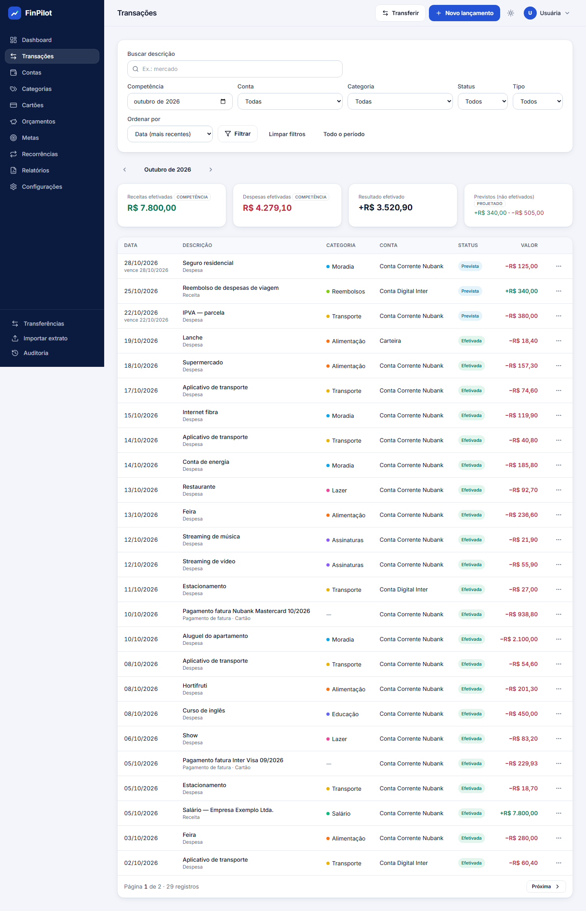
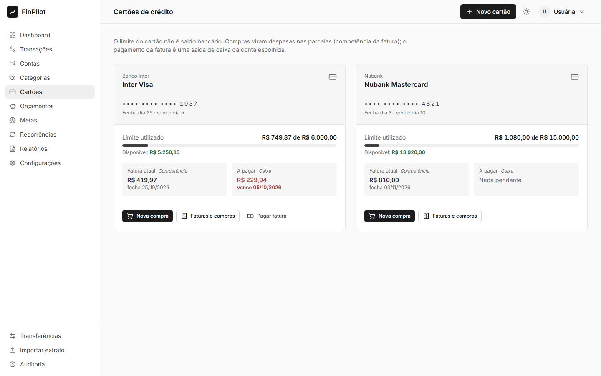
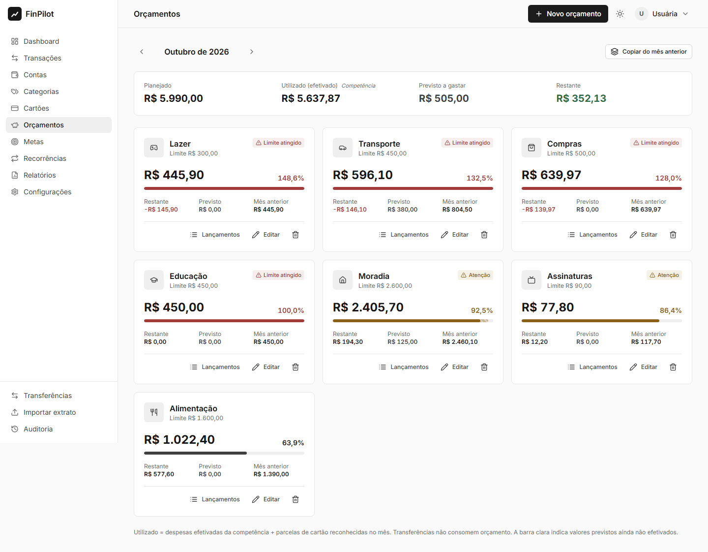
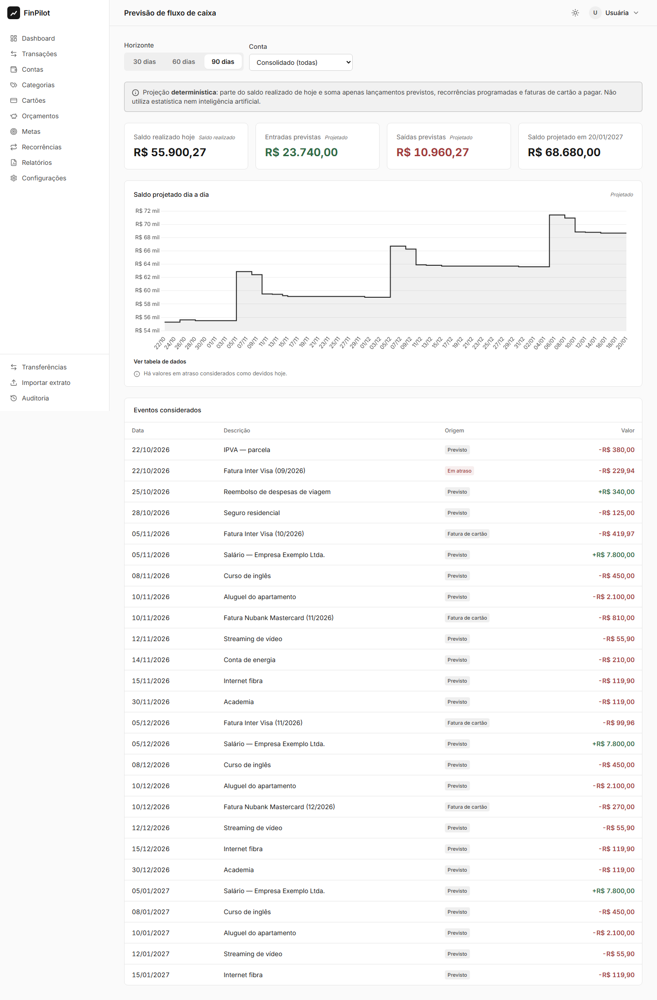
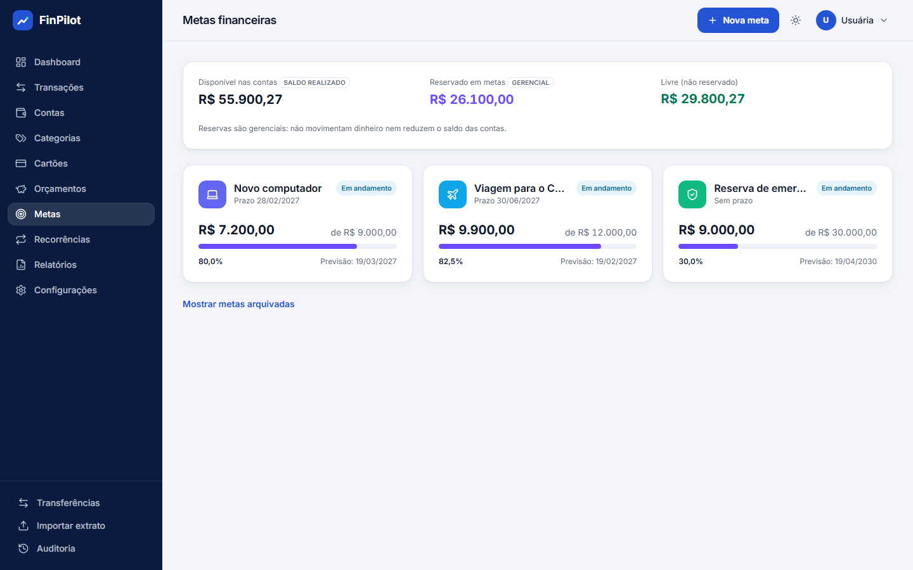
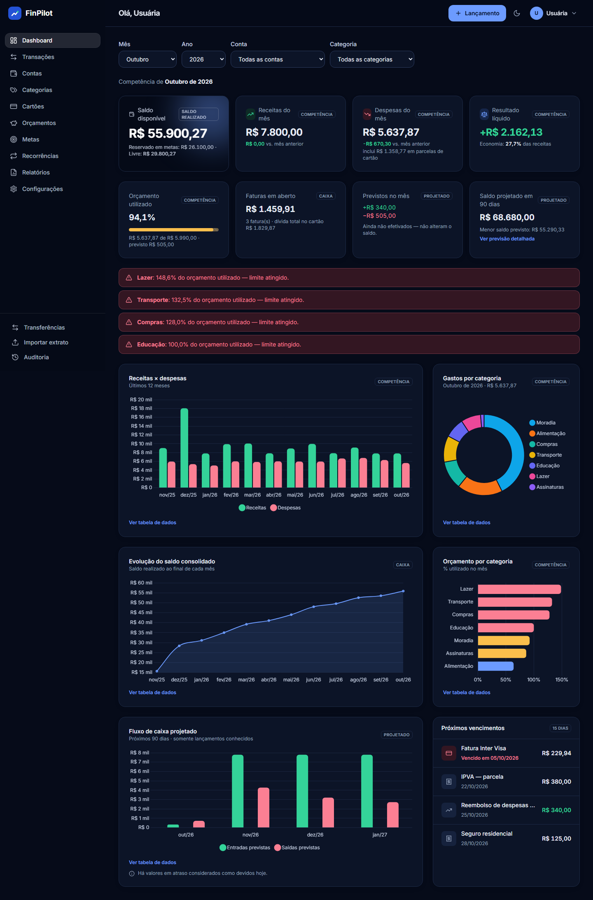
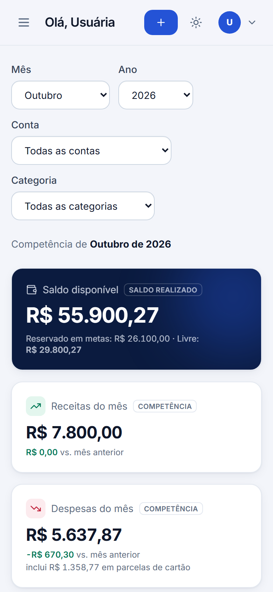

# FinPilot — Plataforma Inteligente de Gestão Financeira

> Contas, cartões, orçamentos, metas, recorrências, importação de extratos e previsão de caixa em um SaaS de finanças pessoais construído com **FastAPI, PostgreSQL e HTMX** — com regras financeiras consistentes ao centavo e segurança desde a primeira linha.



## O problema

Planilhas e apps simples misturam conceitos: compras no cartão aparecem duas vezes (na compra e no pagamento da fatura), transferências viram “receita”, o saldo diverge do extrato e ninguém sabe se o orçamento considera o que ainda vai vencer. O FinPilot separa **competência**, **caixa**, **projeção** e **reservas gerenciais**, e mostra em cada indicador qual regime está sendo usado.

## Funcionalidades

* **Autenticação completa:** cadastro com aceite de privacidade, verificação de e-mail, login com sessões server-side, recuperação de senha, troca de e-mail com nova verificação, encerramento de sessões, exportação e exclusão da conta.
* **Contas** (corrente, poupança, carteira, digital) com saldo inicial, permissão de saldo negativo e arquivamento.
* **Transações** previstas, efetivadas e canceladas, com estorno auditável, edição consistente, histórico, filtros, busca, ordenação e paginação.
* **Transferências** atômicas e idempotentes, que não contam como receita nem despesa.
* **Categorias** por usuário, com padrões no cadastro, cores e ícones.
* **Orçamentos mensais** com alertas em 80% e 100%, previsto separado do realizado e comparação com o mês anterior.
* **Metas** com reservas virtuais (não debitam o banco), estimativa de conclusão e alerta de reserva acima do disponível.
* **Recorrências** diárias, semanais, mensais e anuais, com regra de último dia do mês, geração idempotente por job e edição só das futuras.
* **Importação de CSV** com detecção de delimitador e codificação, mapeamento, prévia validada, duplicatas por ID bancário ou fingerprint e confirmação transacional.
* **Cartões de crédito:** parcelas exatas ao centavo, faturas por fechamento e vencimento, limite disponível, pagamento parcial e estornos.
* **Dashboard** com 8 indicadores e 5 gráficos (Chart.js), filtros via HTMX e tabelas de dados acessíveis.
* **Previsão de caixa** determinística para 30, 60 e 90 dias, com datas de saldo negativo.
* **Relatórios:** 8 relatórios com exportação em CSV (anti-injeção de fórmulas), PDF e impressão.
* **Auditoria** append-only das operações, visível ao usuário.
* **API REST v1** documentada em OpenAPI, sobre os mesmos serviços das telas.
* **Interface:** responsiva, com modo claro, escuro ou do sistema, navegação por teclado e CSP estrita sem JavaScript inline.

## Tecnologias

| Camada | Stack |
|---|---|
| Backend | Python 3.12 · FastAPI · Pydantic 2 · SQLAlchemy 2 · Alembic · psycopg 3 · argon2-cffi · ReportLab |
| Banco / cache | PostgreSQL 16 · Redis 7 (rate limiting) |
| Frontend | Jinja2 (SSR) · HTMX · Tailwind CSS v4 (binário standalone, sem Node) · Chart.js · Lucide · Inter |
| Qualidade | Pytest · HTTPX · Hypothesis · Playwright · Ruff · mypy `--strict` · pre-commit |
| Infra | Docker multi-stage · Docker Compose · Caddy (HTTPS) · GitHub Actions · Mailpit (dev) |

## Arquitetura

Monólito modular: **rotas web e API → serviços (regras e transações) → repositórios e modelos**. As regras puras e determinísticas ficam isoladas em `app/domain`. Detalhes em [docs/ARCHITECTURE.md](docs/ARCHITECTURE.md) e nas [decisões de arquitetura (ADRs)](docs/adr/README.md).





Modelo completo em [docs/DATA_MODEL.md](docs/DATA_MODEL.md).

## Requisitos

* Docker com Docker Compose.
* Para rodar fora de containers: [uv](https://docs.astral.sh/uv/) e Python 3.12 ou superior.
* Binário standalone do Tailwind v4.1.11 em `bin/`. O `make setup` baixa o de Linux; no Windows, use o `tailwindcss-windows-x64.exe`.

## Instalação e execução

```bash
git clone <repo> finpilot && cd finpilot
cp .env.example .env                 # troque TODOS os segredos
make setup                           # dependências + Tailwind
make up                              # postgres, redis, mailpit, migrate, web e scheduler
# ou, sem containers para a aplicação:
make infra && make migrate && make run
```

* Aplicação: <http://localhost:8000>
* E-mails de desenvolvimento (Mailpit): <http://localhost:8025>
* API (OpenAPI): <http://localhost:8000/api/docs>

### Variáveis de ambiente

| Variável | Descrição |
|---|---|
| `ENV` | `development`, `testing` ou `production`. Produção recusa configurações inseguras. |
| `SECRET_KEY` | Segredo de HMAC (CSRF e flash). Em produção, no mínimo 32 caracteres aleatórios. |
| `DATABASE_URL` / `MIGRATOR_DATABASE_URL` | Papel da aplicação (só DML) e papel de migrations (DDL). |
| `POSTGRES_PASSWORD`, `MIGRATOR_DB_PASSWORD`, `APP_DB_PASSWORD` | Senhas usadas pelo compose para criar os papéis. |
| `REDIS_URL`, `RATE_LIMIT_BACKEND` | Rate limiting (`redis` ou `memory`). |
| `EMAIL_BACKEND`, `SMTP_*`, `MAIL_FROM` | Envio de e-mails transacionais. |
| `COOKIE_SECURE`, `SESSION_IDLE_TIMEOUT_MINUTES`, `SESSION_ABSOLUTE_TIMEOUT_HOURS` | Política de sessão. |
| `IMPORT_MAX_BYTES`, `IMPORT_MAX_ROWS`, `EXPORT_MAX_ROWS` | Limites de importação e exportação. |
| `DEMO_EMAIL`, `DEMO_PASSWORD` | Usuário de demonstração, só em desenvolvimento e sem valor padrão no código. |

Lista completa e comentada em [.env.example](.env.example).

### Migrations

```bash
make migrate                         # alembic upgrade head (papel finpilot_migrator)
uv run alembic downgrade base        # todas as migrations são reversíveis e rodam em banco vazio
```

### Dados de demonstração

```bash
make seed        # cria o usuário DEMO_EMAIL com 12 meses de dados fictícios (idempotente)
make seed-reset  # apaga e recria somente o usuário demo
```

O cenário é criado **pelos próprios serviços da aplicação** e inclui 4 contas, salário, freelas, contas fixas, gastos variáveis, transferências, 2 cartões com parcelamentos e faturas pagas, parcial e em aberto, além de recorrências, 3 metas e orçamentos com alertas. Ao final, o script reconcilia todos os saldos com o histórico.

### Testes

```bash
docker compose up -d db-test
make test        # unitários, integração, segurança e concorrência (PostgreSQL real)
make cov         # falha abaixo de 80% em services/domain
make check       # lint + mypy --strict + testes (o mesmo que o CI)
```

Última execução local: **255 testes aprovados** (mais 2 ponta a ponta com Playwright, executados à parte e aprovados). Cobertura de **90,6%** em `app/services` e **96,1%** em `app/domain`. Detalhes em [docs/TESTING.md](docs/TESTING.md).

## Documentação da API

[docs/API.md](docs/API.md) descreve autenticação, CSRF, idempotência, erros RFC 9457, paginação e todos os recursos. A especificação interativa fica em `/api/docs`.

## Principais controles de segurança

* **Senhas:** Argon2id com rehash automático; tokens só como hash; sessões server-side com cookies `HttpOnly`, `SameSite` e `Secure`/`__Host-`, timeout ocioso e absoluto.
* **CSRF:** token por HMAC em todo formulário, requisição HTMX e chamada da API, com verificação de Origin.
* **Controle de acesso:** escopado por usuário em todas as consultas, FKs compostas `(id, user_id)` e resposta 404 para recursos de terceiros.
* **Proteção contra abuso:** rate limiting com 429; idempotência e locks pessimistas nas operações financeiras.
* **Cabeçalhos:** CSP estrita (sem `unsafe-inline`), `nosniff`, `frame-ancestors 'none'`, HSTS em produção.
* **Arquivos e exportações:** uploads validados e nunca gravados em disco; CSV protegido contra injeção de fórmulas.
* **Auditoria e logs:** auditoria append-only (trigger + privilégios mínimos no banco); logs JSON com redação de segredos.

Mapa OWASP completo em [docs/SECURITY.md](docs/SECURITY.md). Regras de negócio rastreadas até o teste em [docs/BUSINESS_RULES.md](docs/BUSINESS_RULES.md).

## Screenshots

Capturas reais da aplicação rodando com o seed de demonstração (`scripts/screenshots.py`).

| Transações | Cartões |
|---|---|
|  |  |
| **Orçamentos** | **Previsão de caixa** |
|  |  |
| **Metas** | **Modo escuro** |
|  |  |

<p align="center"></p>

## Implantação

Servidor Linux com `docker-compose.prod.yml`: Caddy com HTTPS automático, Uvicorn multi-worker com filesystem somente leitura, e PostgreSQL e Redis só na rede interna. Backups são verificados e o restore foi testado. Passo a passo em [docs/DEPLOYMENT.md](docs/DEPLOYMENT.md).

## Limitações conhecidas

* Sem integração bancária (Open Finance) ou coleta de credenciais bancárias, por decisão de escopo.
* Moeda única (BRL) e fuso de apresentação fixo (America/Sao_Paulo).
* Sem crédito positivo no cartão: pagamento acima do devido é recusado.
* Sem 2FA nesta versão.
* E-mails enviados de forma síncrona, sem fila.
* A previsão de caixa é determinística: considera apenas lançamentos conhecidos, sem modelos estatísticos.
* A importação aceita apenas CSV (OFX fica no roadmap).

## Roadmap

* 2FA (TOTP / WebAuthn) e alertas por e-mail de orçamento e vencimentos.
* Importação OFX e regras automáticas de categorização.
* Fila de tarefas para e-mails e jobs (ex.: Redis + worker).
* Multi-moeda e contas de investimento.
* Tokens de API pessoais com escopos, para integrações.

## Licença

MIT.
