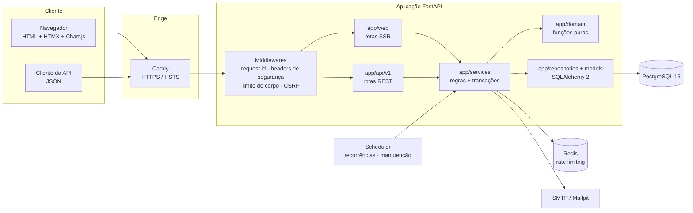
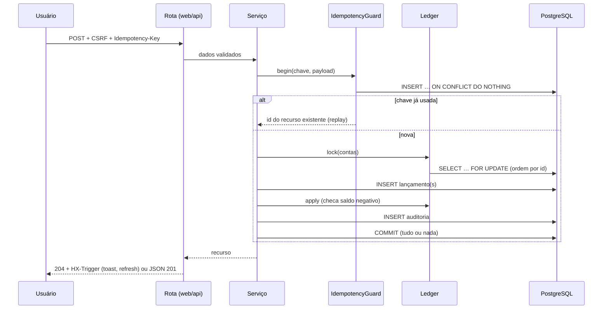
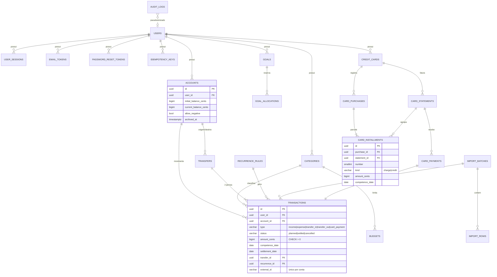

# Arquitetura

FinPilot é um **monólito modular** em FastAPI ([ADR-001](adr/001-monolito-modular.md)). Páginas SSR (Jinja2 + HTMX) e API REST compartilham a mesma camada de serviços — não existe regra financeira implementada duas vezes.

## Visão geral

## Camadas

| Pacote | Responsabilidade |
|---|---|
| `app/core` | Configuração validada, banco, logging JSON, segurança (Argon2id, tokens, CSRF), rate limiting, middlewares, handlers globais de erro, templates |
| `app/domain` | Regras puras e determinísticas: dinheiro, datas/competências, parcelamento e calendário de faturas, recorrências, efeitos no saldo |
| `app/models` | Modelos SQLAlchemy com constraints, índices e FKs compostas `(id, user_id)` |
| `app/repositories` | Acesso escopado por usuário (`get_owned`), paginação e ordenação por lista permitida |
| `app/services` | Casos de uso transacionais (contas, lançamentos, transferências, cartões, orçamentos, metas, recorrências, importação, relatórios, previsão, auditoria, idempotência) |
| `app/web` | Rotas das páginas, leitura de formulários e respostas HTMX (toast, fechamento de drawer, atualização de listas) |
| `app/api/v1` | Recursos REST com schemas Pydantic de entrada (estritos) e saída |
| `app/jobs` | Geração de recorrências, manutenção/retenção e agendador |
| `app/templates`, `app/static` | Layouts, componentes (macros), páginas, parciais HTMX; CSS Tailwind compilado; JS mínimo sem `eval` |

## Fluxo de uma operação financeira

## Regimes financeiros

| Regime | Usado em | Inclui | Exclui |
|---|---|---|---|
| Competência | receitas/despesas, categorias, orçamentos | lançamentos `income`/`expense` pela competência + parcelas de cartão pela fatura | transferências, pagamentos de fatura |
| Caixa | evolução do saldo, movimentações, faturas pagas | lançamentos efetivados pela data de efetivação, incluindo `card_payment` | compras no cartão |
| Projetado | previsão, fluxo projetado | previstos, recorrências futuras, faturas a pagar | transferências (no consolidado) |
| Gerencial | metas | reservas virtuais | — (não movimenta contas) |

Cada card e gráfico exibe o selo do regime utilizado.

## Modelo de dados

Dicionário completo em [DATA_MODEL.md](DATA_MODEL.md).

## Concorrência e consistência

* Locks pessimistas (`FOR UPDATE`) em contas, faturas, cartões e lotes de importação; ordem determinística por id.
* Unicidade no banco como última barreira: idempotência, ocorrências de recorrência, identificador bancário importado, orçamento ativo, faturas por mês.
* Testes em `tests/concurrency/` disparam operações simultâneas com conexões reais.

## Decisões registradas

Veja [docs/adr](adr/README.md).
